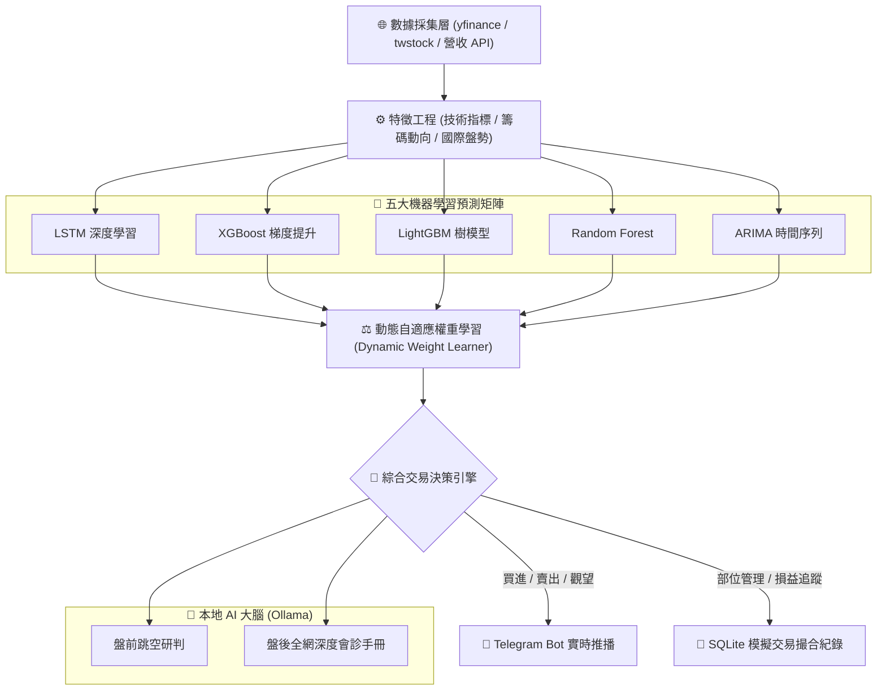

# 📈 Taiwan Stock AI Analyzer (台股 AI 分析與智能量化系統)

> **工業級台股全流程智能量化平台**：整合 **五大機器學習預測矩陣 (LSTM / XGBoost / LightGBM / RF / ARIMA)** + **動態自適應權重學習 (Dynamic Weight Learner)** + **盤中即時撮合與技術指標掃描** + **本地大語言模型 (Ollama LLM) 深度會診** + **Telegram 訊號即時推播**。

---

## 🌟 核心特色 (Core Highlights)

1. **🤖 五大機器學習預測矩陣 (Ensemble ML Matrix)**：
   - **深度學習**：`LSTM` (長短期記憶神經網路，捕捉股價長期趨勢)。
   - **梯度提升樹**：`XGBoost` 與 `LightGBM` (高速特徵交叉，捕捉盤面微結構)。
   - **統計機器學習**：`Random Forest` (隨機森林，評估指標重要性)。
   - **計量時間序列**：`ARIMA` (經典自回歸差分移動平均模型，提供純數理基準)。

2. **⚖️ 動態自適應權重學習 (Dynamic Adaptive Weighting)**：
   - 拒絕傳統僵化的固定權重！系統依據各模型在不同個股近 30~60 天的**實際勝率 (Win Rate)**、**預測方向精準度 (Directional Accuracy)** 與 **夏普比率 (Sharpe Ratio)**，每日自適應重新計算投票權重。 

3. **⏰ 完整台股交易閉環 (Full Market Cycle Pipeline)**：
   - 🌅 **08:30 盤前智能分析**：自動拉取美股指數、ADR、台指期貨盤後盤、跳空缺口與國際大宗商品行情。
   - ⚡ **09:00~13:30 盤中實時模擬**：每分鐘自動掃描盤中報價，計算 RSI、MACD、布林通道與即時異常出量，觸發虛擬撮合。
   - 📊 **15:00 盤後深度體檢**：整合三大法人買賣超、融資融券、類股輪動與產業營收，並交由本地 LLM 生成會診報告。

4. **🧠 本地 AI 大腦 (Local LLM Multi-Provider)**：
   - 支援直連本地 **Ollama**（相容 `gemma4`、`llama3.1`、`nemotron`、`phi4`），零 API 成本、數據絕不上傳外部雲端。

5. **📱 跨平台與即時推播 (Telegram Bot)**：
   - 交易訊號觸發與盤後摘要自動格式化推播至手機 Telegram，支援 Markdown 與長文本自動分頁發送。

---

## 🏗️ 系統架構圖 (Architecture Pipeline)



---

## 🚀 快速開始 (Quick Start)

### 1. 複製專案與建立虛擬環境

```bash
git clone https://github.com/your-username/taiwan-stock-ai-analyzer.git
cd taiwan-stock-ai-analyzer

# 建立並啟動 Python 虛擬環境 (建議 Python 3.10+)
python -m venv venv

# Windows
venv\Scripts\activate
# Linux / macOS
source venv/bin/activate
```

### 2. 安裝必要套件

```bash
pip install -r requirements.txt
```

> 💡 **提示**：TensorFlow 或 PyTorch 擇一安裝即可；TA-Lib 為選用，若環境無編譯器，系統會自動平滑降級至純 Python 技術指標運算。

### 3. 配置環境變數 (`.env`)

複製範本檔案並根據個人需求配置：
```bash
cp .env.example .env
```
編輯 `.env`（選填，若無 Telegram 則所有報告會自動在本地控制台彩色輸出）：
```env
TG_BOT_TOKEN=your_bot_token_here
TG_CHAT_ID=your_chat_id_here
OLLAMA_BASE_URL=http://localhost:11434
OLLAMA_MODEL=gemma4:e4b
```

### 4. 一鍵自檢環境狀態 

```bash
python main.py test
```
*(系統會自動檢驗 Python 套件、本地 Ollama 服務與目錄完整性)*

---

## 💻 統一指令手冊 (CLI Usage)

本專案提供全新的現代化統一入口 `main.py`：

```bash
# 🌅 執行【盤前跳空與國際盤勢智能分析】 (建議於 08:30 執行)
python main.py pre-market

# 📊 執行【盤後籌碼、三大法人與深度體檢】 (建議於 15:00 執行)
python main.py post-market

# ⚡ 啟動【盤中實時模擬交易引擎】 (09:00 - 13:30 自動常駐撮合)
python main.py realtime

# 🔍 啟動【多維度智能股票篩選器】
python main.py screener
python main.py screener --budget 50000        # 依新台幣 5 萬元預算配置投資組合
python main.py screener --strategy etf_only   # 僅篩選優質台股 ETF

# 🧪 執行機器學習模型訓練
python main.py train --symbol 2330.TW         # 訓練台積電單一股票預測模型
python main.py train --all                    # 批次訓練股票池內所有標的

# ⏰ 啟動【全天候自動化巡檢調度器】
python main.py schedule
```

---

## 📂 專案目錄結構

```text
taiwan-stock-ai-analyzer/
├── main.py                         # 現代化統一命令列入口 (Unified CLI)
├── config.yaml                     # 系統核心配置檔
├── config.example.yaml             # 配置範本
├── .env.example                    # 環境變數安全範本
├── requirements.txt                # 依賴套件清單
├── taiwan_stock_utils.py           # 台股 1張=1000股 交易規則與跨平台路徑模組
├── technical_indicators.py         # RSI / MACD / KD / 布林通道演算法
├── smart_stock_screener.py         # 智能選股與預算配置引擎
├── pre_market_analysis.py          # 盤前宏觀數據分析器
├── enhanced_real_post_market_analysis.py # 盤後籌碼與法人會診模組
├── improved_dynamic_weight_learner.py    # 自適應動態權重學習器
├── batch_model_trainer.py          # 多模型矩陣批次訓練器
├── single_stock_trainer.py         # 單股獨立訓練調度器
├── auto_scheduler.py               # 自動定時巡檢器
│
├── realtime_trading_system/        # 盤中實時模擬交易系統
│   ├── realtime_trading_main.py    # 盤中交易主程式
│   ├── telegram_notifier.py        # Telegram 推播整合模組
│   └── core/
│       ├── ai_decision_engine.py   # 即時綜合決策大腦 (AI 60% + 技術 25% + 情緒 15%)
│       └── market_scanner.py       # 實時盤面高頻探針
│
├── data_sources/                   # 數據接口
├── backtest/                       # 策略歷史回測模組
├── scripts/                        # 跨平台排程自動化腳本
└── crontab_examples.txt            # Linux Crontab 定時排程範例
```

---

## 🚨 免責聲明 (Disclaimer)

1. **學術研究用途**：本專案為開源量化研究與機器學習回測系統，系統中所有「模擬交易」、「買進/賣出訊號」與「AI 分析報告」均屬**純粹數理與程式回測**，不對任何實際投資效益作擔保。
2. **非投資建議**：本專案不具備任何證券投資顧問性質，亦不代表任何特定個股之推薦。使用者在進行任何實際金融投資操作時，請務必獨立判斷並自負投資盈虧與風險。
3. **模擬交易**：預設模式為本地虛擬模擬帳戶撮合，絕不連接任何實際券商 API 下單。

---

## 📄 開源授權 (License)

本專案採用 [MIT License](LICENSE) 授權開源。
